# Rockfile

> **A personal relationship file inspired by the Rockefeller card index - contact cards, promises, notes and AI assistants that help you follow up with people on time.**

<picture>
  <source media="(prefers-color-scheme: dark)" srcset="docs/assets/stack-dark.svg">
  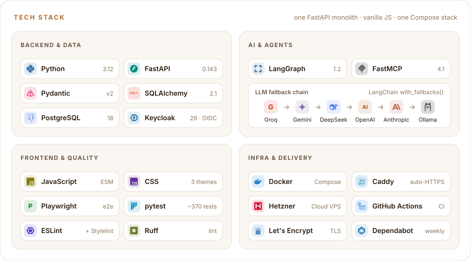
</picture>

**Live:** [getrockfile.com](https://getrockfile.com) - private beta, registration by invite.  
**Source code:** private repository. Access for a code review is available on request.  
**Contact:** `dmitry.v.sychev@gmail.com` · [Telegram](https://t.me/old_healer)

This repository is the public showcase of the project: screenshots, architecture overview, engineering notes and roadmap.

---

## What it is

Rockfile is a personal CRM for people rather than deals. Every contact gets a rich card (family, interests, goals, how you met), a history of interactions and a list of **promises** - things you owe them and things they owe you, with due dates. A **Today** view and checklist-style **notes** turn that context into a daily to-do list, and two LangGraph assistants answer questions over your own data: *"prepare me for the meeting with Anna"*, *"what did I promise and to whom?"*, *"whose birthday is coming up?"*.

It is a solo project built end-to-end: domain model, API, auth, AI agents, frontend, CI/CD and production hosting.

## At a glance

| | |
|---|---|
| Backend tests (pytest) | ~370 |
| End-to-end checks (Playwright) | 18 - every page, theme and language switch, with CSP-violation detection |
| API routers / app pages | 14 / 16 |
| DB migrations (Alembic) | 12 |
| LLM providers in the fallback chain | 6 |
| Code size | ~10.5k lines of Python, ~7k lines of JS (30 ES modules) |
| Commits | 380+ |

## Screenshots

### Landing

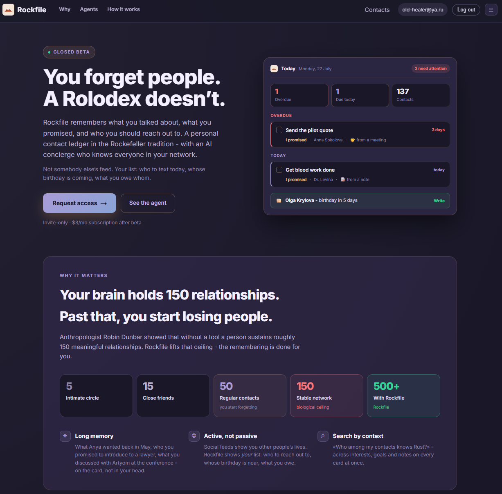

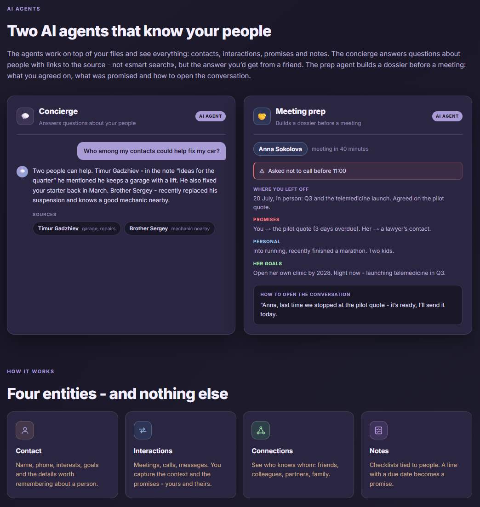

### Contacts - who to reach out to today, then the full list

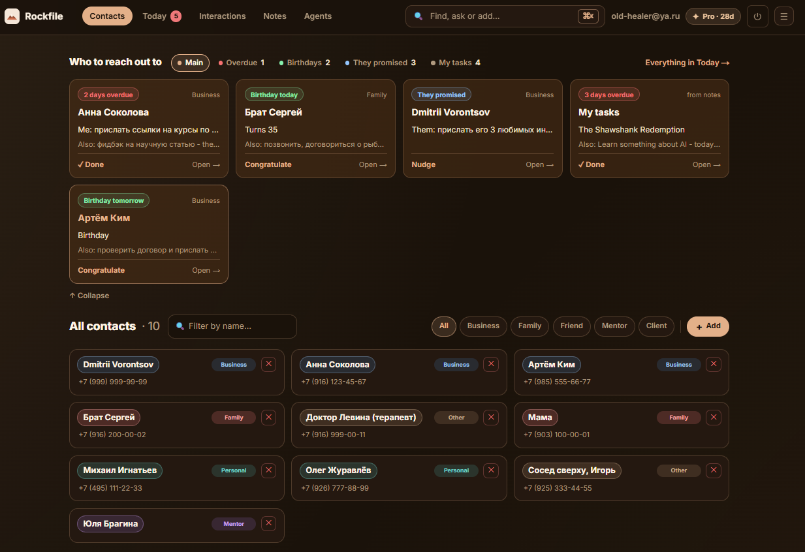

### Today - overdue, due today and this week

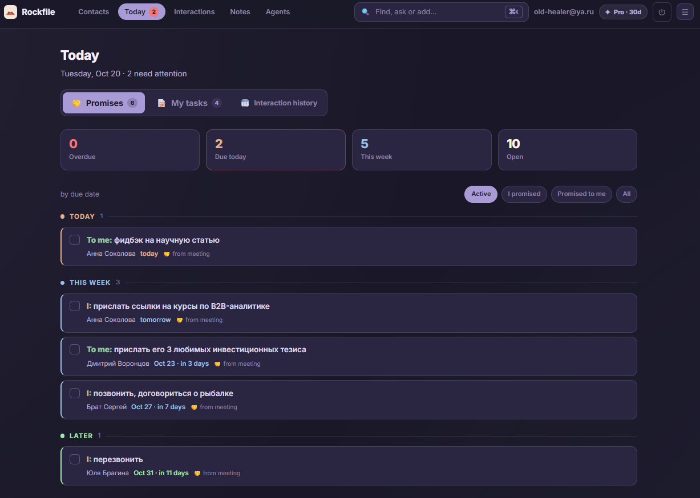

### Contact card - profile, personal details, goals

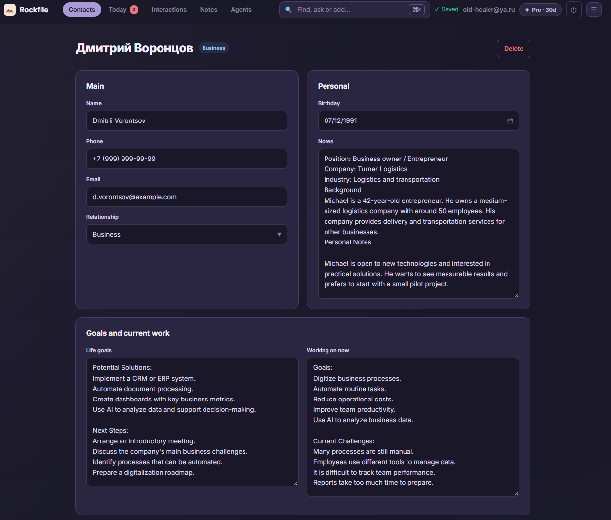

### Contact card - interactions, relationships and contact statistics

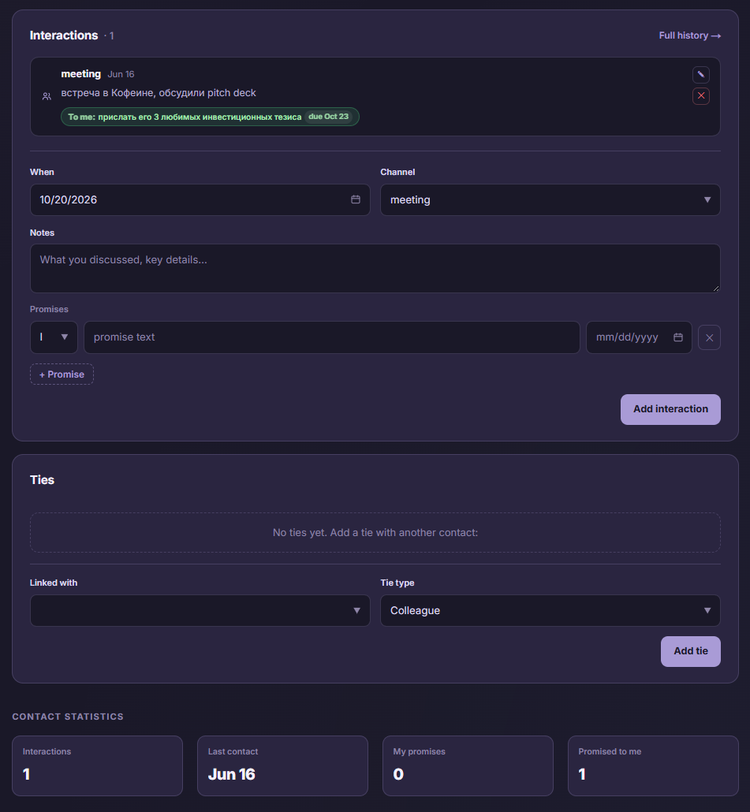

### Interactions - history across all contacts, with filters

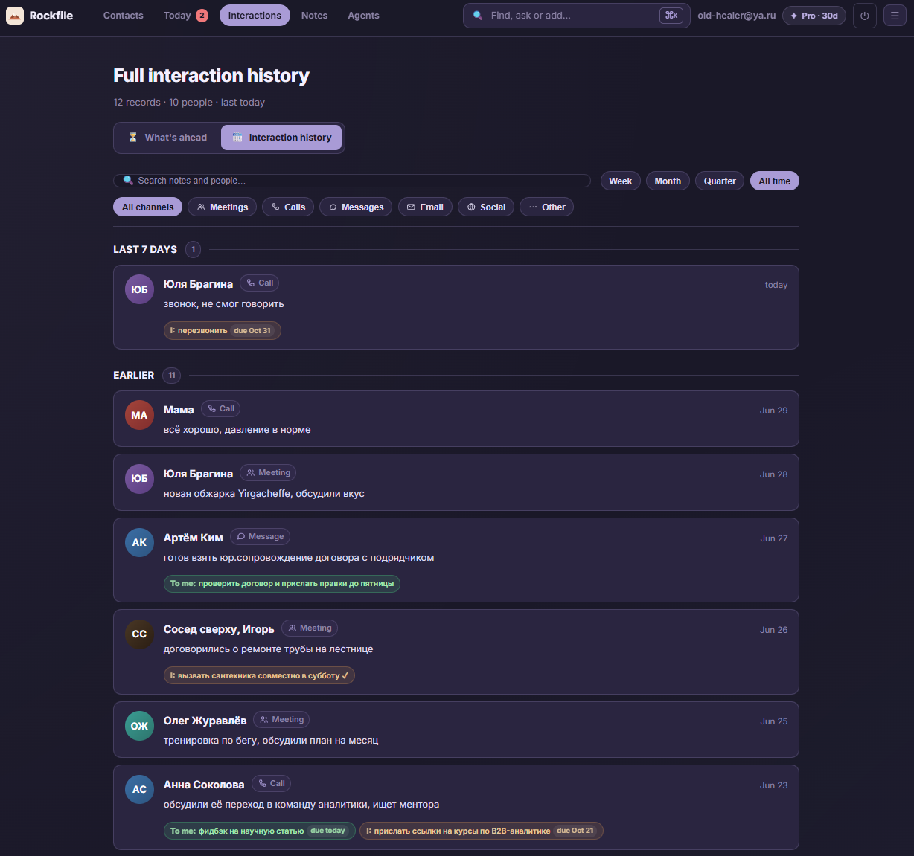

### Notes - checklists that turn into promises

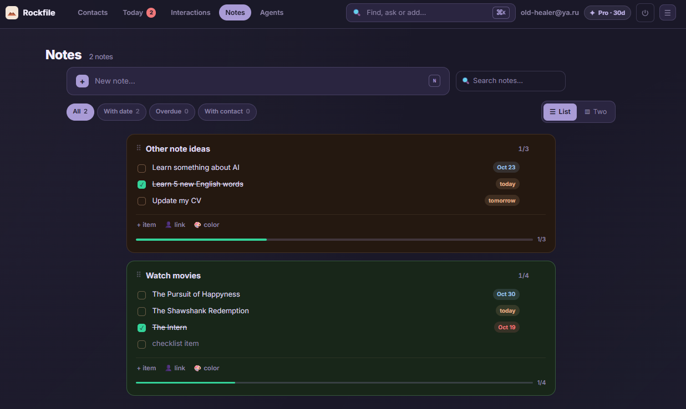

### Command palette (⌘K)

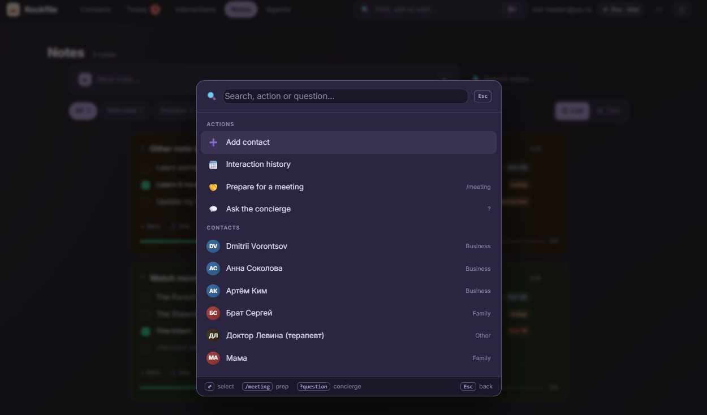

### AI assistants - Concierge with grounded sources and meeting prep

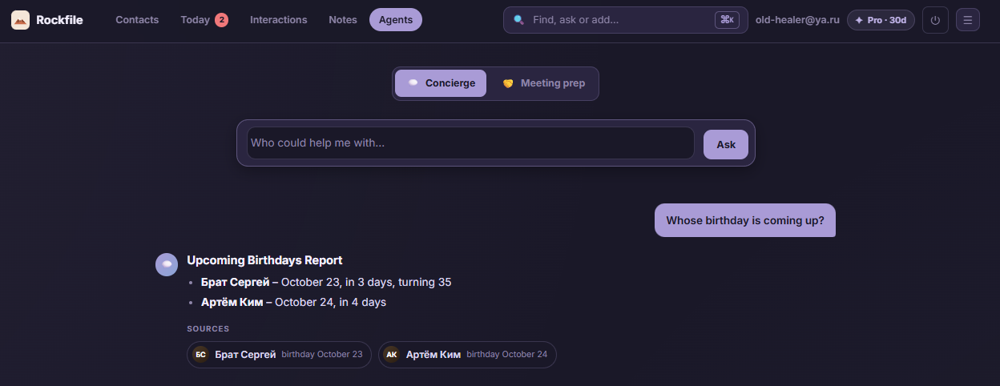

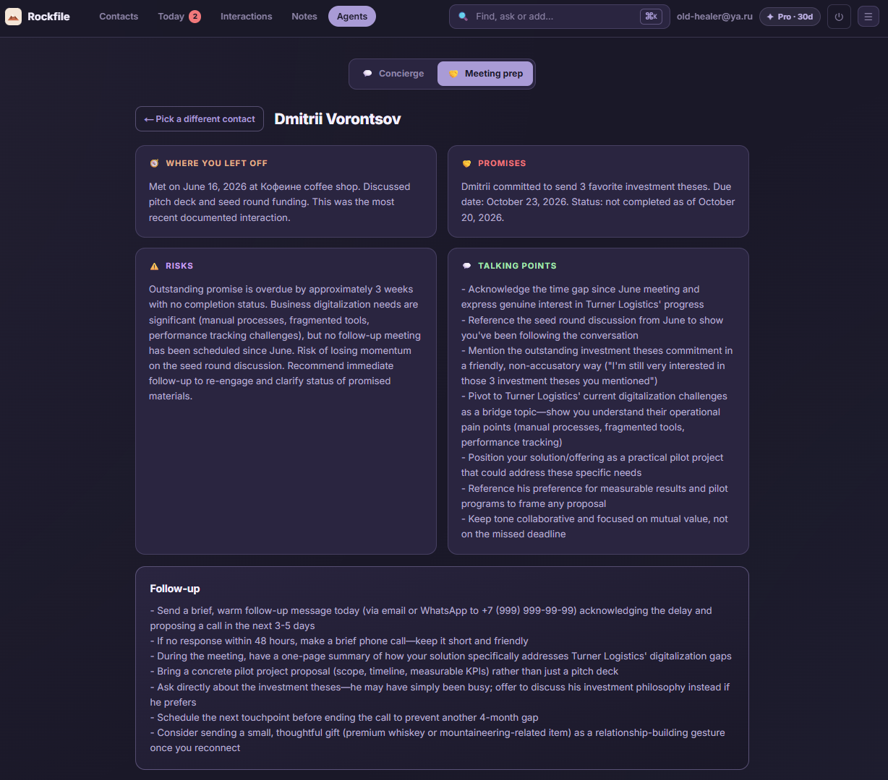

### Themes and language switcher - Amber and Light

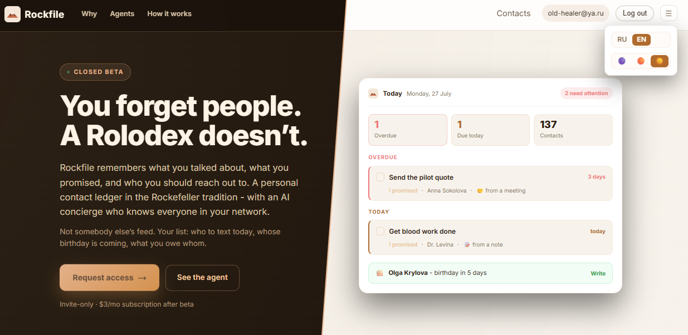

## Features

**Contacts and relationships**
- Contact cards: identity, relationship type, family members, birthday, interests, goals, free-form notes; autosave
- Relationship graph between contacts (who knows whom and in what context)
- Interaction history (meetings, calls, messages) per contact and across the whole file, with filters
- Import from vCard and CSV (Google Contacts, Outlook, column mapping by synonyms)

**Promises, Today and notes**
- Promises in both directions ("I owe" / "they owe") with due dates and completion tracking
- Today view: overdue / today / this week, with a counter in the header of every page
- Checklist notes with colors, pinning and drag-and-drop; a row with a due date on a note linked to a contact becomes a promise, and checking it off closes the promise (and vice versa)

**AI assistants (LangGraph)**
- *Prepare for a meeting* - multi-step pipeline: load history → summarize → advise → format
- *Concierge* - intent routing (birthdays / promises / matchmaker / clarify) with sources attached deterministically, so the model cannot invent references
- Six-provider fallback chain (Groq → Gemini → DeepSeek → OpenAI → Anthropic → Ollama), every attempt logged with provider, tokens and latency
- Answers in the interface language

**Interface**
- Vanilla JS multi-page app, no framework and no build step
- Full English and Russian UI, translated on the server so pages never flash in the wrong language
- Three themes (Purple, Amber, Light), custom date picker, command palette (⌘K or `/`), keyboard shortcuts (`?`)
- Mobile layout with bottom navigation, PWA manifest, self-hosted font
- Undo for destructive actions, skeleton loading, empty states, in-app feedback button

**Accounts and access**
- Keycloak (OIDC/JWT): sign-up, email verification, password reset, auto-refresh, account deletion
- Invite-only registration with race-safe code redemption; access periods managed from the admin panel
- Multi-tenant data model (`tenant_id` on every business row)
- Transactional email through Resend or SMTP with Jinja2 templates

**Admin panel**
- Usage counters, user list with search, ban / verify / extend access / delete
- Invite management, AI call log, product roadmap stored in the database

## Architecture

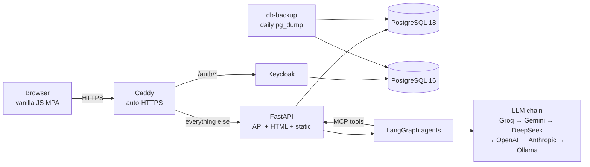

One Docker Compose stack on a Hetzner Cloud VPS in Finland. Details: [`docs/ARCHITECTURE.md`](docs/ARCHITECTURE.md).

## Tech stack

| Layer | Choice |
|---|---|
| Backend | Python 3.12, FastAPI, Pydantic v2, pydantic-settings |
| Data | PostgreSQL 18, SQLAlchemy 2.1 (async, asyncpg), Alembic |
| Auth | Keycloak 26 (OIDC / JWT), multi-tenant data |
| AI | LangGraph, FastMCP, LangChain providers: Groq, Gemini, DeepSeek, OpenAI, Anthropic, Ollama |
| Frontend | HTML + CSS + vanilla JS (ES modules), JSON i18n dictionaries shared by browser and server |
| Email | Resend (HTTPS API) or SMTP, Jinja2 templates |
| Quality | pytest, Playwright, ESLint, Stylelint, Prettier, Ruff |
| Infra | Docker Compose, Caddy + Let's Encrypt, Hetzner Cloud VPS |
| CI/CD | GitHub Actions: tests, compose validation and image smoke test on every PR; SSH deploy with automatic rollback; TruffleHog secret scan; Dependabot |

## Engineering highlights

Short write-ups of the less obvious decisions are in [`docs/ENGINEERING_NOTES.md`](docs/ENGINEERING_NOTES.md):

- **Strict CSP without `unsafe-inline`** in a no-bundler app - script hashes are computed from the HTML at startup, rolled out via Report-Only and an e2e violation check
- **Server-side i18n for a vanilla-JS app** - one set of JSON dictionaries for browser and server, no flash of untranslated text, CSP hashes untouched
- **Cache busting without a build step** - ETag revalidation instead of 80+ hand-maintained `?v=` query strings
- **LLM fallback chain** across six providers with a per-attempt audit log
- **Grounded AI answers** - sources come from the graph, not from the model
- **Deploy with automatic rollback** on a failed production smoke test
- **AWS → Hetzner migration** - version pinning, server hardening, atomic backups
- **Race-safe invites and multi-tenancy**, two-way notes ↔ promises sync, single-flight token refresh

## Roadmap

Next up: Telegram bot with a morning digest, data export, product analytics (funnel and retention), paid beta. See [`docs/ROADMAP.md`](docs/ROADMAP.md).

## Documentation

- [`docs/ARCHITECTURE.md`](docs/ARCHITECTURE.md) - domain model, layers, production setup, CI/CD
- [`docs/AGENTS.md`](docs/AGENTS.md) - AI assistants, LLM chain, MCP
- [`docs/ENGINEERING_NOTES.md`](docs/ENGINEERING_NOTES.md) - engineering decisions and their reasoning
- [`docs/ROADMAP.md`](docs/ROADMAP.md) - what has been built and what is next

## License

Proprietary - All Rights Reserved. The content of this repository is published for viewing and reference only; no rights are granted to use, copy, modify, or run the software. See [`LICENSE`](LICENSE) for the full text.

Licensing inquiries: dmitry.v.sychev@gmail.com.  
Ideas or questions: [Telegram](https://t.me/old_healer).
