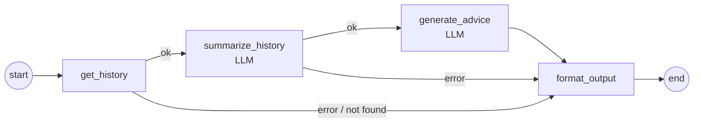
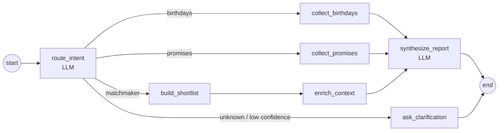

# AI assistants

Rockfile has two assistants built with **LangGraph**. Both follow the same rule: **data comes from Rockfile, the model only compresses and phrases it.** Control flow, data loading and anything that has to be correct (which contacts, which promises, which sources) is deterministic code in graph nodes; LLM nodes get a prepared context and return structured JSON.

## 1. Prepare for a meeting

*"Prepare me for the meeting with Anna."* The user picks a contact in the UI, the API (`POST /api/v1/agents/prepare-meeting`) runs a linear graph:

| Node | Kind | What it does |
|---|---|---|
| `get_history` | tool | Loads the card, relationship links and recent interactions through the `contacts_get` MCP tool |
| `summarize_history` | LLM | Who this person is, what you talked about, open promises on both sides, mutual connections |
| `generate_advice` | LLM | Topics to raise, follow-ups to close, an optional draft message |
| `format_output` | code | Builds the response for the UI; also the single exit for errors, so every failure becomes a readable message instead of a 500 |

## 2. Concierge

A single chat entry point for questions over the whole file (`POST /api/v1/agents/concierge`). The first node classifies the intent, the graph branches:

- **birthdays** - contacts with birthdays in the requested window.
- **promises** - open promises, split into "I owe" and "they owe".
- **matchmaker** - "who could help me with X": a shortlist from search, then the top candidates are enriched with full context before the answer is written.
- **unknown** - if the intent is not recognised or the classifier's confidence is below 0.5, the agent asks a clarifying question instead of guessing.

**Grounded sources.** Every answer comes with a list of the contacts it is based on, with a reason for each ("birthday on …", "3 open promises", "matches your request"). The list is filled by the collect / enrich nodes, never by the model, so the UI can link to real cards and the model has no way to invent a reference.

Each run also keeps a short audit trail in its state (`intent=promises confidence=0.92`, `contacts_list(q=…) → 7 contacts`), which makes debugging a wrong answer a matter of reading the trace.

## LLM layer

All agents get their model from one factory:

- **Fallback chain**: primary provider plus an ordered list of fallbacks from configuration, combined with LangChain's `with_fallbacks()`. The production order is **Groq → Gemini → DeepSeek → OpenAI → Anthropic → Ollama**: free tiers first, cheap paid providers next, local model last. Providers without an API key are skipped silently, so the chain can be configured once and filled in gradually.
- **Per-attempt audit**: every LLM call - including failed attempts that triggered a fallback - is written to the `agent_calls` table with agent, provider, model, input/output tokens, latency and status. The admin panel shows this log, which is how fallbacks are noticed and costs are tracked.
- **Language**: prompts carry the interface language, so answers come back in English or Russian to match the UI.
- **Privacy in logs**: request texts, names and notes are logged only at DEBUG level; production logs contain lengths and statuses.

## MCP

Data access for agents goes through a **FastMCP** tool layer (`ping`, `contacts_list`, `contacts_get`, `promises_list`). A tool receives the user's access token, validates it, opens a DB session and calls the regular service layer - the same tenant-scoped code the REST API uses. The agent never touches the database directly.

Two modes are supported:

| Mode | How tools are called | Use |
|---|---|---|
| `mcp` (default) | In-process FastMCP client, token-authenticated | Production; the same tools can be exposed to external MCP clients |
| `local` | Direct calls into the service layer with the request's DB session | Tests and local debugging |

A stdio entry point for the MCP server exists as well, for connecting the tools to desktop MCP clients during development.

## What is next

- Assistant actions in the Telegram bot (morning digest of birthdays and due promises).
- Exposing the MCP server to external clients with proper per-user authorization.
