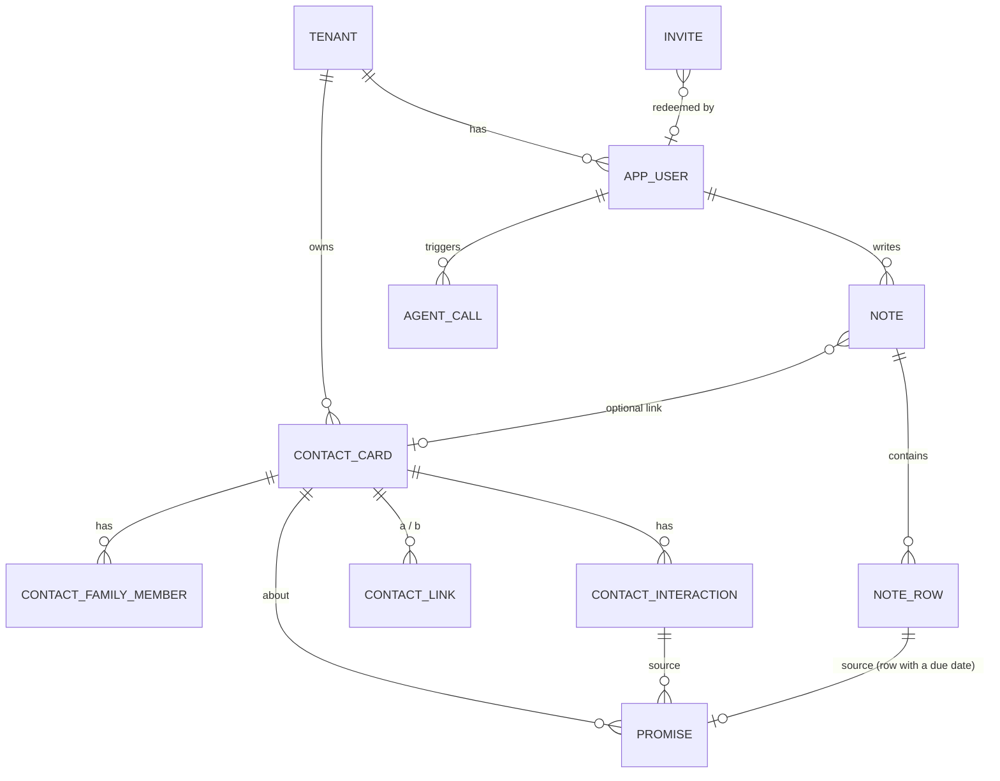
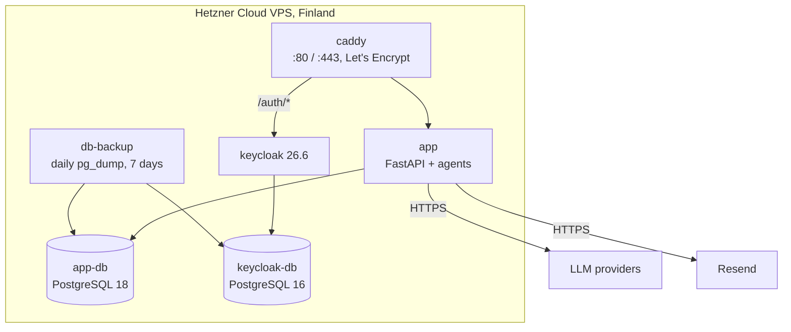

# Architecture

Rockfile is a modular monolith: one FastAPI application serves the JSON API, the HTML pages and the static assets, and hosts the AI agents in-process. Identity lives in Keycloak. Everything runs as one Docker Compose stack.

## Domain model



| Entity | Purpose |
|---|---|
| `Tenant` | Isolation boundary. Every business row carries `tenant_id`; one tenant is created per user at sign-up |
| `AppUser` | Link between the Keycloak subject and local data: tenant, ban flag, access expiry, last login |
| `ContactCard` | The card itself: identity, relationship type (business / personal / other), interests, hobbies, goals, ambitions, birthday, personal notes, `is_demo` flag for seeded data |
| `ContactFamilyMember` | Family members of a contact, with their own birthdays |
| `ContactLink` | Edge of the relationship graph between two contacts: type, context, directed or not |
| `ContactInteraction` | A meeting, call or message with date, channel, notes and mentions |
| `Promise` | Commitment in either direction (`mine` / `theirs`) with a due date and completion time. Its source is an interaction or a note row; if the source is deleted the promise stays for history |
| `Note`, `NoteRow` | Checklist notes, private to a user, optionally linked to a contact; rows are text or checkboxes with an optional due date |
| `Invite` | One-time registration code with expiry, revocation and redemption info |
| `AgentCall` | Audit record of every LLM attempt: agent, provider, model, tokens, latency, status |
| `RoadmapItem` | Public product roadmap managed from the admin panel |

Contact search uses PostgreSQL full-text search: generated `tsvector` columns with GIN indexes and `websearch_to_tsquery`.

## Backend layers

```
sources/
  api/
    routers/v1/    HTTP layer: validation, auth dependency, tenant scoping
    services/      business logic; every function takes the DB session as its first argument
    schemas/       Pydantic request/response models
    data_base/     SQLAlchemy models and async session
    auth/          JWT validation against Keycloak JWKS (cached), Keycloak admin client
    templates/     Jinja2 email templates
    i18n.py        API error messages in the interface language
    i18n_html.py   server-side translation of HTML pages
  agents/          LangGraph graphs, LLM factory, MCP tools
  web/             HTML pages, CSS, ES modules, i18n dictionaries, fonts
  settings.py      configuration through pydantic-settings
```

Conventions that hold across the code base:

- **Async everywhere**, SQLAlchemy 2 typed models. Collection relationships are `lazy="raise"`, so an accidental lazy load in async code fails loudly in tests instead of silently issuing queries; loading is always explicit.
- **Tenant scoping in the router layer**: every endpoint takes the tenant from the authenticated user, never from the request.
- **Configuration only through `settings.py`** (nested pydantic-settings), no direct `os.getenv`.
- **Migrations run at application startup** (lifespan), the app container starts only after the database is healthy.

API surface (14 routers under `/api/v1`): auth, contacts (CRUD, stats, import, demo cleanup), links, contact interactions and promises, global interactions feed, search, promises / today, notes and rows (with reordering), subscription, invites, roadmap, agents, admin. OpenAPI docs are served at `/api/docs`.

## Frontend

A multi-page app in plain HTML, CSS and ES modules - no framework and no build step. This was a deliberate choice for a small product with mostly form-like screens, and it was re-validated during a frontend audit.

- **16 pages**, each with its own entry module; shared code in `ui.js` (API client, tokens, toasts, escaping), `nav.js`, `dialog.js`, `datepicker.js`, `palette.js` (⌘K), `shortcuts.js`.
- **i18n**: JSON dictionaries per screen. The browser imports them as JSON modules, the server uses the same files to render the page in the user's language (see [Engineering notes](ENGINEERING_NOTES.md#server-side-i18n-for-a-vanilla-js-app)).
- **Themes**: Purple, Amber and Light, implemented as CSS custom-property tokens under `:root[data-theme]`; the theme is applied by a tiny inline script before first paint.
- **Mobile**: bottom navigation below 1024px, `100dvh` layouts, PWA manifest and theme color.
- **Tooling**: ESLint, Stylelint, Prettier; Playwright smoke suite.

## Authentication

- Keycloak handles credentials; the app talks to it through the admin API for sign-up, verification and account deletion, and validates access tokens against the realm's JWKS.
- Keycloak is exposed under `/auth/*` on the same domain, so the browser only ever talks to one origin (`connect-src 'self'`).
- Access tokens are refreshed in the background shortly before they expire; parallel 401 responses share a single refresh request because Keycloak rotates refresh tokens.
- Registration requires an invite code; access can be time-limited and extended by an admin.

## Production



- **Server bootstrap** is a single idempotent script: Docker with log rotation, an unprivileged deploy user with a read-only deploy key, swap, `ufw` (22/80/443 only), `fail2ban`, unattended security upgrades, key-only SSH with root login disabled.
- **Versions are pinned** where an upgrade would be silent and destructive - for example Keycloak, whose newer images migrate the database schema on start.
- **Backups**: a dedicated container on the `postgres:18` image (a newer `pg_dump` can dump the older Keycloak database, not the other way round) dumps both databases every night in custom format, writes through a temporary file so a broken dump never looks complete, takes a dump on start if today's is missing, and keeps seven days. Off-site copies are on the roadmap.
- Hosting moved from AWS (EC2 + RDS) to Hetzner in October 2026 - see [Engineering notes](ENGINEERING_NOTES.md#aws--hetzner-migration).

## CI/CD

| Workflow | Trigger | What it does |
|---|---|---|
| `test` | PR to `master`, push to `dev` / `master` | pytest against a PostgreSQL service; `docker compose config` for dev and prod files; build the image, start it, wait for the app (migrations included) and fetch the OpenAPI schema |
| `deploy` | push to `master`, manual | over SSH: fetch, rebuild and restart the app, smoke-test the public URL; on failure roll back to the previous commit, rebuild and verify again; result in the job summary |
| `secrets-scan` | PR, push | TruffleHog, verified secrets only |
| Dependabot | weekly / monthly | Python dependencies and GitHub Actions, PRs into `dev` |

Development happens on `dev`; `master` is what runs in production and is protected.
